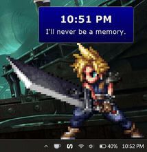
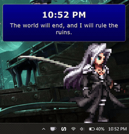
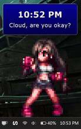

# Peek Buddy Animated

A fun reminder for the top of every hour or at the times you choose: an animated character GIF pops up from the bottom corner of your screen, stands on top of the taskbar for a few seconds, says something in a dialogue box, and leaves again. It appears at the top of every hour and at any other times you choose, on top of all your apps.

  

## Characters

Characters are organized into packs. Choose which pack **Random** picks from in settings. If you pick a specific character, it is shown no matter which pack is selected:

- **Final Fantasy VII** - Cloud, Sephiroth, and Tifa

More packs will be added in future updates.

## What is it?

- Real animated GIF characters, not drawn shapes.
- The character slides up smoothly and fades out.
- 12-hour clock with AM/PM, or 24-hour (your choice in settings).
- Dialogue box with quotes from the characters.
- The box shows the time and a quote, or just the time, or your own message.

## Install in Windhawk

1. Open Windhawk.
2. Click **Create new mod**.
3. Open `peek-buddy-animated.wh.cpp`, select all, copy, and paste it into the Windhawk editor.
4. Click **Compile mod**, then **Install**.

## Notes

- The mod runs in its own `windhawk.exe` process and does not inject into other programs. It does not change any system or registry setting.
- The GIFs are embedded in the mod file, so there is nothing to download.
- The character window never takes the keyboard focus. If **Click to dismiss** is off, the character is click-through and the mouse goes straight to the app below.
- It appears above the taskbar edge (the work area), as if it stands on it.
- The character stands right against the corner edge. The dialogue box opens inwards, into the screen.

## Credits

This is a non-commercial fan project. Character sprites are from various sources and belong to their respective creators. This mod is not affiliated with or endorsed by any game company.

The original Hourly Peek Buddy mod is by DahaSakinOlamazdim.
