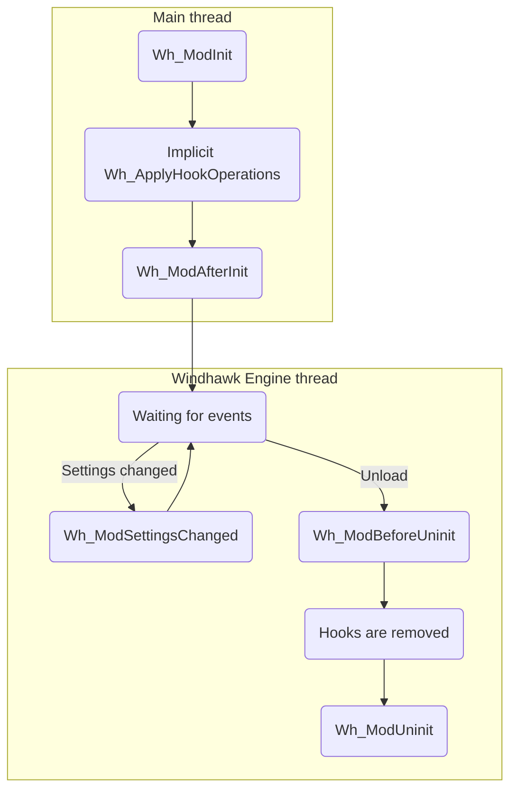

Here is a simple flow chart representing the lifetime of a mod:

Notes:
* The flow chart represents the lifetime of a mod which is loaded before the target process begins its execution. In case a mod is loaded into a process which is already running, all events are executed in the Windhawk Engine thread.